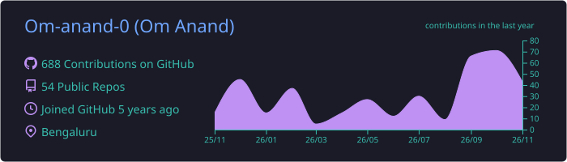
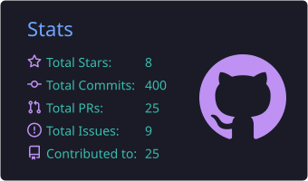
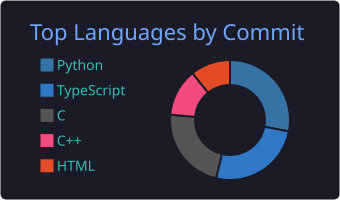

<p align="center">
  <a href="https://omanand0.in"></a>
</p>

<p align="center">
  <a href="https://omanand0.in"></a>
  <a href="https://linkedin.com/in/omanand10"></a>
  <a href="mailto:om.d3v.21@gmail.com"></a>
  <a href="https://youtube.com/@Om-Anand"></a>
</p>

---

### whoami

```python
class OmAnand:
    role      = "AI Engineer Intern @ BrainChain Labs"
    studying  = "B.Tech CSE, final year (2027)"
    based_in  = "Bhopal, India  ->  open to relocate"
    building  = ["RAG systems", "multi-agent tools", "voice AI", "GPU simulations"]
    shipped   = ["context-asr on PyPI", "merged PR in BitChord (v1.9)"]
    off_hours = ["editing video", "ricing Linux", "breaking things on purpose"]

    def looking_for(self):
        return "AI / software engineering internships that turn into full-time"
```

---

### Things I've built

<table>
<tr>
<td width="50%" valign="top">

**[Windtunnel](https://github.com/Om-anand-0/windtunnel_vis)**
<br/><sub>TypeScript · WebGPU · WGSL · Three.js</sub>

A real lattice Boltzmann CFD solver running on your GPU, in the browser. Drop in any 3D car, watch the air move. Validated in CI against published references (Strouhal 0.173 vs 0.166), and interpolated walls cut sedan drag error from 2.05 to 0.91.

</td>
<td width="50%" valign="top">

**[context-asr](https://pypi.org/project/context-asr/)** &nbsp;
<br/><sub>Python · Whisper · spaCy</sub>

Speech-to-text that notices what you're talking about. Mention "Game of Thrones" and it pulls in the right names, so *Daenerys Targaryen* stops coming out as "to Ennery's". `pip install context-asr`

</td>
</tr>
<tr>
<td width="50%" valign="top">

**AI Digital Twin**
<br/><sub>FastAPI · Qdrant · Llama 3.2 · VoxCPM · Docker</sub>

Talk to a lip-synced 3D avatar of me. Whisper in, RAG over Qdrant, out through a TTS voice I fine-tuned with LoRA. Three isolated Docker services, so a TTS crash never takes the API down.

</td>
<td width="50%" valign="top">

**[Analytics Q&A Agent](https://github.com/Om-anand-0/PocketToon_Assignment)**
<br/><sub>Python · Instructor · SQLGlot · Slack</sub>

Ask your database a question in Slack, get a table or chart back. Every query is parsed into an AST and checked (read-only, whitelisted tables) before it runs, and validator errors loop back so the agent fixes its own SQL.

</td>
</tr>
<tr>
<td width="50%" valign="top">

**[Thumbnail Brain Test](https://github.com/Om-anand-0/Thumbnail-Brain-Test)**
<br/><sub>Next.js · MediaPipe · Claude API</sub>

Drops three thumbnail options into a fake YouTube feed and predicts which one eyes land on first, with a saliency model and face detection that run in about 100 ms.

</td>
<td width="50%" valign="top">

**Swasth AI**
<br/><sub>FastAPI · Ollama · Qdrant · SSE</sub>

A medical RAG assistant that answers only from retrieved sources, streams replies live and asks before calling tools. I cut its latency from about 20 s to 6 s.

</td>
</tr>
</table>

---

### Tech I reach for

<p>
  
</p>

<p>
  
  
  
  
  
  
  
  
</p>

---

### Stats

<p align="center">
  
</p>
<p align="center">
  
  
</p>

<p align="center">
  <picture>
    <source media="(prefers-color-scheme: dark)" srcset="https://raw.githubusercontent.com/Om-anand-0/Om-anand-0/output/github-snake-dark.svg" />
    
  </picture>
</p>


